# DOCUMENTAÇÃO TÉCNICA DO SISTEMA
## Bora Pedir Delivery

| Campo | Informação |
| :--- | :--- |
| **Grupo:** | Bora Pedir Delivery |
| **Nome do Integrante:** | Kathleen Alves De Oliveira |
| **Tema:** | Sistema de delivery com foco em automação e transparência de taxas para o comércio |
| **Curso técnico:** | Análise e Desenvolvimento de Sistemas |
| **Instituição:** | SENAI — Serviço Nacional de Aprendizagem Industrial |

---

## Sumário

* [1. Visão Geral e Arquitetura do Sistema](#1-visão-geral-e-arquitetura-do-sistema)
  * [1.1. Apresentação do Ecossistema](#11-apresentação-do-ecossistema)
  * [1.2. Perfis de Usuário (Atores)](#12-perfis-de-usuário-atores)
  * [1.3. Visão Geral dos Atores / Papéis do Sistema](#13-visão-geral-dos-atores--papéis-do-sistema)
* [2. Especificação Funcional dos Módulos](#2-especificação-funcional-dos-módulos)
  * [2.1. Módulo: Delivery Site (Web)](#21-módulo-delivery-site-web)
    * [2.1.1. Cadastro e Análise Administrativa (Admin)](#211-cadastro-e-análise-administrativa-admin)
    * [2.1.2. Portal de Gestão](#212-portal-de-gestão)
    * [2.1.3. Gestão de Pedidos](#213-gestão-de-pedidos)
    * [2.1.4. Painel Administrativo (Admin)](#214-painel-administrativo-admin)
  * [2.2. Módulo: App do Cliente (`bora_pedir_app`)](#22-módulo-app-do-cliente-bora_pedir_app)
    * [2.2.1. Acesso e Cadastro Simplificado](#221-acesso-e-cadastro-simplificado)
    * [2.2.2. Estrutura de Navegação (Barra Inferior / Navbar)](#222-estrutura-de-navegação-barra-inferior--navbar)
    * [2.2.3. Tela do Comércio, Cardápio e Fluxo de Compra](#223-tela-do-comércio-cardápio-e-fluxo-de-compra)
    * [2.2.4. Processo de Realização do Pedido](#224-processo-de-realização-do-pedido)
  * [2.3. Módulo: App do Entregador (`bora_pedir_entregador`)](#23-módulo-app-do-entregador-bora_pedir_entregador)
    * [2.3.1. Acesso e Autenticação](#231-acesso-e-autenticação)
    * [2.3.2. Mapa ao Vivo e Busca de Entregas](#232-mapa-ao-vivo-e-busca-de-entregas)
    * [2.3.3. Fluxo Operacional de Coleta e Entrega (Dupla Validação)](#233-fluxo-operacional-de-coleta-e-entrega-dupla-validação)
* [3. Stack Tecnológica e Arquitetura de Software](#3-stack-tecnológica-e-arquitetura-de-software)
  * [3.1. Plataforma Web e API (Delivery)](#31-plataforma-web-e-api-delivery)
  * [3.2. App do Cliente (`bora_pedir_app`)](#32-app-do-cliente-bora_pedir_app)
  * [3.3. App do Entregador (`bora_pedir_entregador`)](#33-app-do-entregador-bora_pedir_entregador)
* [4. Manual de Instalação e Execução do Sistema](#4-manual-de-instalação-e-execução-do-sistema)
  * [4.1. Pré-requisitos de Ambiente (Instalação no Sistema Operacional)](#41-pré-requisitos-de-ambiente-instalação-no-sistema-operacional)
  * [4.2. Instalação das Dependências (Primeira Execução)](#42-instalação-das-dependências-primeira-execução)
  * [4.3. Execução dos Módulos (Passo a Passo)](#43-execução-dos-módulos-passo-a-passo)
* [5. Modelagem de Dados (`bora_pedir_delivery`)](#5-modelagem-de-dados-bora_pedir_delivery)
  * [5.1. Modelo Entidade-Relacionamento (MER)](#51-modelo-entidade-relacionamento-mer)
  * [5.2. Diagrama Entidade-Relacionamento (DER)](#52-diagrama-entidade-relacionamento-der)
  * [5.3. Dicionário de Dados (Todas as 24 Tabelas)](#53-dicionário-de-dados-todas-as-24-tabelas)
* [Apêndice A. Código-Fonte do Diagrama Entidade-Relacionamento (Mermaid)](#apêndice-a-código-fonte-do-diagrama-entidade-relacionamento-mermaid)

---

## 1. Visão Geral e Arquitetura do Sistema

### 1.1. Apresentação do Ecossistema

O projeto consiste em um ecossistema integrado de Delivery projetado para conectar estabelecimentos comerciais, consumidores finais e profissionais de entrega. Para atender às necessidades específicas de cada ponta dessa operação, a solução foi dividida em três aplicações distintas que compartilham uma mesma base de dados e regras de negócio centralizadas:

* **Delivery Site (Painel Administrativo Web):** Plataforma web destinada à gestão operacional dos estabelecimentos e da administração geral do sistema. É por meio deste módulo que o restaurante gerencia seu cardápio, acompanha a entrada de novos pedidos em tempo real, atualiza o status de preparo e visualiza relatórios financeiros e de desempenho.
* **App Bora Pedir (Aplicativo do Cliente):** Aplicação mobile voltada ao consumidor final. Permite o cadastro de usuários, navegação pelo catálogo de produtos, realização de pagamentos e o acompanhamento do status do pedido até a entrega.
* **App Bora Pedir Entregador (Aplicativo Logístico):** Aplicação mobile exclusiva para os parceiros de entrega. O módulo gerencia a disponibilidade do entregador, notifica novas solicitações de coleta, exibe rotas otimizadas até o estabelecimento e até o endereço do cliente, além de registrar a confirmação de entrega.

### 1.2. Perfis de Usuário (Atores)

O sistema é estruturado em quatro papéis de usuário (*roles*) distintos: **Cliente**, **Comércio**, **Entregador** e **Administrador (Admin)**. A arquitetura de autenticação foi projetada para permitir que uma mesma pessoa utilize um único endereço de e-mail para exercer múltiplos papéis na plataforma, sem que haja conflito de dados entre as contas.

O direcionamento e o isolamento das permissões ocorrem de acordo com a aplicação utilizada no momento do login, conforme detalhado a seguir:

* **Cliente:** Possui acesso exclusivo ao aplicativo *Bora Pedir*, destinado à navegação pelo catálogo e realização de pedidos.
* **Comércio:** Possui acesso restrito ao *Portal de Gestão (Delivery Site)*, onde administra seu cardápio, pedidos e operações do estabelecimento.
* **Entregador:** Acessa exclusivamente o aplicativo *Bora Pedir Entregador*, voltado ao recebimento e execução das rotas de entrega.
* **Administrador (Admin):** Perfil restrito a usuários previamente autorizados, com acesso ao painel administrativo para auditar dados cadastrais e aprovar ou recusar o ingresso de novos comércios e entregadores na plataforma.

### 1.3. Visão Geral dos Atores / Papéis do Sistema

* **Cliente (Consumidor Final):** Responsável por explorar os estabelecimentos disponíveis, montar o carrinho, escolher a forma de pagamento, acompanhar o status do pedido em tempo real e validar a entrega.
* **Comércio (Estabelecimento Parceiro):** Gerencia seu cardápio, recebe e prepara os pedidos, registra a prova fotográfica de despacho e utiliza ferramentas de gestão financeira como o cálculo de repasse líquido por venda e a precificação inteligente baseada no custo dos insumos.
* **Entregador (Logística):** Recebe as solicitações de entrega disponíveis, visualiza rotas e endereços, realiza a coleta no estabelecimento e confirma a finalização da entrega ao cliente.
* **Administrador (Gestão da Plataforma):** Supervisiona o funcionamento global do sistema, gerencia cadastros e aprovações de comércios e entregadores, configura taxas operacionais e monitora métricas gerais da plataforma.

---

## 2. Especificação Funcional dos Módulos

### 2.1. Módulo: Delivery Site (Web)

O módulo de Delivery / Painel do Comércio (*Delivery*) é a interface operacional destinada aos estabelecimentos parceiros (restaurantes, mercados, farmácias, adegas e lojas locais). Ele atua como o centro de comando da operação diária, permitindo receber e aceitar pedidos em tempo real, gerenciar o preparo na cozinha, solicitar entregadores da rede, além de controlar o catálogo de produtos e o faturamento. Existe também a parte do cadastro de comércio e entregador, que passa por uma análise do ADMIN, onde se verifica se os documentos cadastrados estão de acordo para operar na plataforma, gerando um e-mail de aprovação ou recusa para o interessado no cadastro.

#### 2.1.1. Cadastro e Análise Administrativa (Admin)

O sistema possui fluxos de cadastro específicos para Entregadores e Comerciantes, ambos submetidos à análise administrativa e ao controle de situação cadastral:

* **Cadastro de Entregador:** Exige que o candidato seja maior de idade e possua Carteira Nacional de Habilitação (CNH) válida. Ao preencher e enviar o formulário, o sistema dispara um e-mail automático informando que os dados passarão por análise, e o cadastro assume o status `Pendente`.
* **Cadastro de Comerciante:** Exige que o estabelecimento possua CNPJ ou registro de MEI ativo para operar na plataforma. O fluxo de envio segue o mesmo padrão do entregador, iniciando com o status `Pendente` e gerando o mesmo e-mail automático de confirmação de recebimento para análise.

Para ambos os perfis, a situação cadastral evolui conforme a validação da administração e o uso da plataforma:

* **Aprovado:** Atribuído após a validação dos documentos pelo administrador, momento em que um novo e-mail automático é enviado confirmando a aprovação e liberando o acesso.
* **Suspenso:** Aplicado caso o comerciante ou entregador sofra alguma penalização na plataforma.
* **Inativo:** Definido quando o usuário solicita a exclusão de sua conta.

#### 2.1.2. Portal de Gestão

O Portal de Gestão é o ambiente onde o comerciante administra o seu negócio. Antes de iniciar a operação diária, um comércio recém-aprovado passa pela etapa de **Primeiro Acesso**, na qual cadastra o nome do estabelecimento, endereço, horários de funcionamento, dados bancários, além do logotipo e do banner que serão exibidos no aplicativo dos clientes.

Após essa configuração inicial, o comerciante passa a utilizar o Dashboard, organizado nas seguintes abas funcionais:

* **Início:** Página inicial do painel que apresenta dicas de boas práticas para o estabelecimento se posicionar melhor dentro da plataforma.
* **Gestão de Pedidos:** Área operacional em tempo real onde o comércio recebe, aceita ou recusa novos pedidos, acompanha as etapas de preparo, registra a foto de prova do despacho e solicita o entregador para a coleta.
* **Cardápio:** Funcionalidade (também acessível diretamente pela aba de Gestão de Pedidos) que permite criar categorias, cadastrar novos produtos, visualizar, editar e excluir itens, além de gerenciar preços e disponibilidade.
  * **Automação de Busca de Imagens no Cadastro de Itens:** Durante o cadastro de um novo item no cardápio, o sistema oferece um recurso de automação para busca de imagens, desenvolvido para agilizar a montagem da vitrine pelos comerciantes que não possuem fotos próprias dos produtos:
    * *Busca Automatizada via Bing:* A partir do termo pesquisado pelo lojista, o sistema consulta o mecanismo de busca Bing e captura os links das imagens correspondentes.
    * *Seleção entre 5 Opções:* A ferramenta exibe até 5 sugestões de imagens para que o comerciante visualize e escolha a mais adequada para o item.
    * *Nova Busca sob Demanda:* Caso nenhuma das 5 opções apresentadas atenda à preferência do lojista, ele pode acionar uma nova busca para gerar outras alternativas de imagens antes de salvar o produto.
* **Pedidos:** Reúne o histórico completo de todos os pedidos realizados na loja, exibindo o detalhamento de cada venda — como identificador (ID) do pedido, nome do cliente, endereço de entrega, itens solicitados, valores cobrados e o demonstrativo transparente das taxas aplicadas no delivery, explicando exatamente o que foi descontado.
* **Avaliações:** Exibe as opiniões registradas pelos clientes sobre determinados pedidos comprados, apresentando a avaliação por meio de uma escala de até 5 estrelas, o comentário escrito pelo consumidor e as fotos anexadas por ele referentes ao pedido recebido.
* **Financeiro:** Apresenta o histórico de valores a receber pelo estabelecimento, acompanhado de métricas como o volume de vendas na semana, o número total de pedidos, o comportamento de pagamento dos clientes (distribuição entre PIX, cartão ou dinheiro) e um gráfico ilustrativo de desempenho.
* **Precificação:** Ferramenta de apoio que auxilia o comerciante a calcular e posicionar adequadamente o preço de venda dos seus produtos na plataforma, evitando prejuízos operacionais.
* **Minhas Promoções:** Lista e detalha todos os itens que estão atualmente em promoção por escolha da loja, exibindo seus respectivos valores promocionais.
* **Participar de Promoções:** Disponibiliza pacotes padrão e recursos de automação para que o comércio aplique descontos em seus itens. Por regra de negócio, o sistema impede que o valor promocional seja superior ao preço original, permitindo a ativação apenas quando o novo valor for inferior ao preço regular do produto.
* **Perfil:** Exibe os dados cadastrais do estabelecimento como nome, logotipo, banner, CNPJ e informações da conta financeira cadastrada permitindo que o lojista edite essas informações quando necessário.
* **Horários de Funcionamento:** Permite cadastrar e editar a grade de horários da loja; os períodos configurados determinam automaticamente quando o estabelecimento aparece como aberto no aplicativo, enquanto os intervalos sem cadastro mantêm a loja fechada.

#### 2.1.3. Gestão de Pedidos

A tela de Gestão de Pedidos é a área operacional dedicada ao recebimento e à administração do fluxo diário de vendas do estabelecimento. A operação ocorre por meio de um painel organizado por etapas — contemplando o acompanhamento geral dos pedidos em andamento, os **Pedidos em Entrega** (após a liberação para o entregador) e os **Pedidos Concluídos** (histórico das entregas finalizadas) —, além de contar com a aba **Dúvidas**, um canal direto em que qualquer usuário do aplicativo pode entrar em contato com o comércio antes mesmo de realizar uma compra para esclarecer questões sobre o estabelecimento, itens ou ingredientes.

* **Abertura e Fechamento Automático/Manual:**
  * O sistema abre e fecha a loja automaticamente conforme a grade de horários semanal configurada (segunda a domingo).
  * Botão de emergência *"Pausar Loja / Fechar Temporariamente"* para momentos de pico excessivo na cozinha ou imprevistos operacionais.
* **Recebimento, Detalhamento e Comunicação:** Quando um novo pedido chega ao painel, o comerciante possui a opção de aceitar ou recusar a solicitação. Ao aceitar, o pedido entra na etapa de preparo e libera o acesso completo ao seu Detalhamento, que reúne:
  * *Identificação e Dados da Entrega:* ID do pedido, nome do cliente e endereço completo de destino.
  * *Resumo Financeiro e Transparência de Taxas:* Relação dos itens solicitados, valores cobrados e o demonstrativo claro das taxas aplicadas pela plataforma, detalhando o motivo de cada desconto realizado sobre o pedido.
  * *Chat Vinculado ao Pedido:* Canal direto de comunicação que permite tanto ao comércio entrar em contato com o cliente quanto ao cliente falar com o estabelecimento durante o andamento daquele pedido específico.
* **Sistema Antifraude e Prova Fotográfica do Preparo:** Dentro do detalhamento, o sistema disponibiliza um mecanismo antifraude baseado no registro de evidências visuais (fotos do pedido). O objetivo dessa funcionalidade é proteger o estabelecimento contra solicitações indevidas de reembolso feitas de má-fé por consumidores que alegam problemas inexistentes na entrega. O envio das fotos é opcional, sendo uma decisão do próprio comerciante utilizá-lo ou não, de modo a não comprometer a agilidade operacional em horários de pico ou estabelecimentos com alto volume de demanda. Quando registradas, as imagens ficam armazenadas no histórico do comércio e são enviadas ao cliente em tempo real, cumprindo uma dupla função: servem como respaldo probatório para o lojista e permitem que o consumidor acompanhe visualmente as etapas de montagem e embalagem, reduzindo a ansiedade durante a espera pelo pedido.
* **Finalização do Preparo e Logística com Dupla Validação por Código:** Ao concluir o preparo, o comerciante aciona a opção *"Marcar como Pronto"*, o que dispara automaticamente a solicitação de entrega para os entregadores da rede, que podem aceitar ou recusar a corrida. A partir do aceite do entregador, a logística segue duas etapas de validação por segurança:
  * *Liberação no Comércio (Código de Retirada):* O sistema gera um código aleatório de 4 dígitos. Quando o comerciante informa e valida esse código para o entregador no momento da coleta, o pedido avança para a aba **Pedidos em Entrega** (`Saiu para Entrega`).
  * *Finalização no Cliente (Código de Entrega):* Na etapa final, ao chegar ao destino, o entregador solicita ao cliente um segundo código aleatório de 4 dígitos para confirmar o recebimento. Com essa validação, a entrega é encerrada e o registro passa a constar na aba **Pedidos Concluídos**.

#### 2.1.4. Painel Administrativo (Admin)

O Painel Administrativo é o ambiente restrito destinado à gestão e moderação geral do ecossistema, reunindo as seguintes funcionalidades:

* **Auditoria e Aprovação de Cadastros:** Permite ao administrador visualizar e analisar as solicitações de registro enviadas por novos comércios e entregadores, possuindo autonomia para aprovar ou recusar cada cadastro.
* **Consulta de Dados Cadastrais:** Disponibiliza acesso às informações detalhadas dos estabelecimentos comerciais e dos entregadores cadastrados na plataforma.
* **Indicadores Gerais do Sistema:** Exibe métricas consolidadas sobre a operação da rede, incluindo o total de Solicitações de Cadastro, Entregadores Ativos e Comércios Ativos.
* **Mapa de Área de Atuação:** Apresenta um mapa visual indicando as cidades em que o Bora Pedir está disponível e em operação.

---

### 2.2. Módulo: App do Cliente (`bora_pedir_app`)

O módulo Bora Pedir App (`bora_pedir_app`) é a aplicação mobile destinada aos usuários consumidores, permitindo explorar estabelecimentos parceiros, realizar pedidos e acompanhar todo o processo de entrega em tempo real.

#### 2.2.1. Acesso e Cadastro Simplificado

* **Cadastro e Autenticação:** Para criar uma conta, o cliente realiza um cadastro simples informando apenas nome, e-mail, senha e telefone, com liberação imediata de acesso (sem necessidade de aprovação administrativa).
* **Navegação Livre vs. Compra Autenticada:** O usuário pode navegar livremente pelo aplicativo e visualizar os comércios e seus respectivos cardápios sem estar logado. No entanto, para adicionar itens e concluir um pedido, é obrigatório estar autenticado na conta.

#### 2.2.2. Estrutura de Navegação (Barra Inferior / Navbar)

A navegação principal do aplicativo é organizada em quatro abas centrais:

* **Início:** Exibe os banners promocionais da plataforma, as categorias de comidas para filtragem rápida, comércios e o ícone de acesso ao carrinho de compras.
* **Procurar:** Apresenta sugestões de pratos e disponibiliza uma barra de pesquisa para buscar diretamente pelo nome de um comércio ou de um produto específico.
* **Pedidos:** Reúne o histórico de solicitações do cliente, organizadas entre pedidos em andamento, cancelados e concluídos. Ao selecionar um pedido em andamento, o cliente visualiza o nome do estabelecimento, os itens solicitados, o valor total, as provas fotográficas enviadas pelo comércio e o acompanhamento detalhado das etapas de status:
  * *Recebido:* Indica que o pedido foi enviado e aguarda a confirmação do comércio para iniciar o preparo.
  * *Em Preparo:* Informa que o estabelecimento aceitou o pedido e está preparando os itens.
  * *A Caminho:* Sinaliza que o pedido já foi coletado e está em rota de entrega até o cliente.
  * *Entregue:* A finalização e liberação da entrega ocorrem somente após o cliente informar o código verificador ao entregador no momento do recebimento.
  * *Avaliação Pós-Entrega:* Após a conclusão do pedido, o aplicativo disponibiliza a opção de avaliação (de caráter opcional), na qual o cliente pode registrar sua opinião sobre o pedido e anexar fotos.
* **Perfil:** Exibe os dados cadastrais informados pelo cliente na criação da conta, permitindo também adicionar ou alterar sua foto de perfil.

#### 2.2.3. Tela do Comércio, Cardápio e Fluxo de Compra

Ao selecionar um estabelecimento no aplicativo, o cliente acessa a página do comércio, que apresenta as seguintes informações e recursos:

* **Identidade e Informações da Loja:** Exibição do logotipo, banner e descrição do estabelecimento, além do status em tempo real indicando se a loja está aberta ou fechada e seus respectivos horários de atendimento.
* **Avaliações do Estabelecimento:** Exibição da nota média em estrelas; ao clicar sobre ela, o cliente visualiza todas as avaliações já registradas para aquele comércio.
* **Chat de Dúvidas:** Canal de atendimento direto que permite ao usuário entrar em contato com o estabelecimento para esclarecer dúvidas antes mesmo de realizar qualquer pedido.
* **Navegação e Busca no Cardápio:** Barra de pesquisa interna para localizar produtos específicos dentro da loja e listagem organizada por categorias, exibindo cada item com sua respectiva foto e valor.

#### 2.2.4. Processo de Realização do Pedido

Para efetuar uma compra, o cliente segue as seguintes etapas:

1. **Carrinho e Endereço:** Adiciona os itens desejados ao carrinho de compras e informa o endereço de entrega.
2. **Seleção de Pagamento:** Escolhe entre as modalidades disponíveis Cartão de Crédito/Débito, PIX (que gera um código para pagamento) ou Dinheiro.
3. **Acompanhamento e Finalização:** Após o envio, o cliente aguarda o comércio receber, preparar e liberar o pedido para entrega. Por fim, no momento do recebimento, informa o código de 4 dígitos ao entregador para validar e concluir o pedido.

---

### 2.3. Módulo: App do Entregador (`bora_pedir_entregador`)

O módulo Bora Pedir Entregador (`bora_pedir_entregador`) é a aplicação mobile destinada aos parceiros logísticos responsáveis pela coleta e entrega dos pedidos.

#### 2.3.1. Acesso e Autenticação

* **Login Exclusivo:** Ao abrir o aplicativo, o sistema solicita as credenciais de acesso do entregador. O aplicativo não possui tela de cadastro — todo o registro e envio de documentação devem ser realizados previamente pelo site Delivery, onde o perfil passa pela análise administrativa antes de ter o login liberado.

#### 2.3.2. Mapa ao Vivo e Busca de Entregas

* **Geolocalização em Tempo Real:** Após efetuar o login, a tela principal exibe um mapa com a localização atual do entregador ao vivo, acompanhado de um sistema ativo para buscar e receber chamadas de pedidos disponíveis.
* **Notificação e Análise da Corrida:** Quando uma entrega é disparada para o entregador, o aplicativo exibe os detalhes essenciais para a tomada de decisão:
  * Endereço de retirada (estabelecimento);
  * Endereço de destino (cliente);
  * Valor da taxa que o entregador receberá pela corrida.
* **Decisão do Parceiro:** Com base nessas informações, o entregador possui a opção de aceitar ou recusar a solicitação de entrega.

#### 2.3.3. Fluxo Operacional de Coleta e Entrega (Dupla Validação)

Ao aceitar uma entrega, o aplicativo conduz o entregador por duas etapas sequenciais de segurança:

1. **Coleta no Estabelecimento (Código de Retirada):** O sistema exibe o endereço de retirada para o deslocamento até o comércio. Ao chegar ao local, o entregador deve inserir o código de 4 dígitos informado pelo comerciante para liberar o pedido e confirmar a retirada.
2. **Entrega ao Consumidor (Código de Finalização):** Com o pedido liberado, o aplicativo passa a exibir o endereço completo do cliente para a rota de entrega. Ao chegar ao destino final, o entregador solicita e insere o código de 4 dígitos do cliente para validar a entrega e encerrar a corrida.

---

## 3. Stack Tecnológica e Arquitetura de Software

### 3.1. Plataforma Web e API (Delivery)

A aplicação web Delivery foi desenvolvida utilizando TypeScript e JavaScript, estruturada em duas camadas principais: uma interface frontend reativa para a operação dos comerciantes e administradores, e uma API backend responsável pelas regras de negócio, autenticação e comunicação com o banco de dados.

**Camada Frontend (Interface Web)**
* **React (`v19.2.8`) e React DOM (`v19.2.8`):** Biblioteca principal utilizada para a construção das interfaces de usuário baseadas em componentes reutilizáveis.
* **Vite (`v8.2.1`) e `@vitejs/plugin-react` (`v6.0.5`):** Ferramenta de build e servidor de desenvolvimento responsável pela compilação otimizada da aplicação web.
* **TypeScript (`v6.0.3`):** Superset do JavaScript utilizado para tipagem estática e maior segurança no desenvolvimento do código.
* **React Router DOM (`v7.18.2`):** Gerenciamento de rotas e navegação entre as páginas públicas (cadastro/login) e as áreas restritas do Portal de Gestão e do Painel Administrativo.
* **Recharts (`v3.10.1`):** Biblioteca utilizada para a renderização dos gráficos de desempenho financeiro no dashboard do comerciante.
* **React Simple Maps (`v5.0.5`):** Componente utilizado no Painel Administrativo para a renderização do mapa visual das cidades onde a plataforma está em operação.

**Camada Backend (API e Regras de Negócio)**
* **Node.js e Express (`v5.2.1`):** Ambiente de execução e framework web responsáveis pela criação das rotas da API REST, processamento de requisições e integração entre o site, os aplicativos mobile e o banco de dados.
* **MariaDB Driver (`mariadb v3.5.4`):** Conector oficial utilizado para realizar a comunicação e execução de consultas no banco de dados relacional MariaDB.
* **JSON Web Token — `jsonwebtoken` (`v9.0.3`):** Utilizado para geração e validação de tokens de autenticação e controle de sessão dos usuários.
* **Bcrypt.js (`v3.0.3`):** Biblioteca empregada para a criptografia (hash) de senhas antes do armazenamento no banco de dados.
* **Multer (`v2.5.0`):** Middleware utilizado para o tratamento e upload de arquivos de imagem (como logotipos, banners, fotos de itens do cardápio e provas fotográficas dos pedidos).
* **Nodemailer (`v10.0.4`):** Biblioteca responsável pelo disparo automático de e-mails transacionais, como as notificações de análise e aprovação de cadastros de comerciantes e entregadores.
* **CORS (`v2.8.6`):** Controle de políticas de compartilhamento de recursos entre origens distintas, permitindo que os aplicativos mobile e o frontend consumam a API com segurança.
* **Dotenv (`v17.4.2`) e UUID (`v14.0.2`):** Gerenciamento de variáveis de ambiente sensíveis (credenciais do banco e chaves de acesso) e geração de identificadores únicos.

**Ferramentas de Qualidade e Tipagem (Desenvolvimento)**
* **Oxlint (`v1.77.0`):** Ferramenta de análise estática (*linter*) para padronização e verificação de qualidade do código.
* **Tipagens (`@types/node`, `@types/react`, `@types/react-dom`):** Pacotes de definição de tipos para suporte ao TypeScript no ambiente Node.js e React.

### 3.2. App do Cliente (`bora_pedir_app`)

O aplicativo mobile voltado aos consumidores foi desenvolvido de forma multiplataforma utilizando **Flutter (`v3.41.7`)** e a linguagem **Dart (`v3.11.5`)**, permitindo compilação nativa a partir de uma base única de código.

**Dependências Principais (Produção)**
* **Flutter SDK (`v3.41.7`) e Dart SDK (`v3.11.5`):** Framework de interface e linguagem base responsáveis pela renderização dos componentes visuais e lógica da aplicação mobile.
* **`http` (`v1.6.0`):** Biblioteca utilizada para realizar requisições REST e comunicação assíncrona com a API backend do sistema (autenticação, listagem de comércios, cardápios, envio de pedidos e acompanhamento de status).
* **`shared_preferences` (`v2.5.6`):** Recurso de armazenamento local persistente empregado para manter dados de sessão e o token de autenticação do cliente no dispositivo.
* **`image_picker` (`v1.2.4`):** Plugin nativo utilizado para acessar a câmera ou a galeria do dispositivo, permitindo ao usuário selecionar e enviar fotos tanto para o seu perfil quanto para as avaliações dos pedidos concluídos.
* **`flutter_svg` (`v2.3.2`):** Biblioteca responsável pela renderização de ícones e elementos gráficos vetoriais (SVG) com alta nitidez em diferentes densidades de tela.
* **`cupertino_icons` (`v1.0.9`):** Pacote padrão de ícones para suporte visual aos componentes da interface.

**Ferramentas de Desenvolvimento e Qualidade**
* **`flutter_lints` (`v3.0.2`):** Conjunto de regras de análise estática utilizadas para manter as boas práticas e a padronização do código Dart.
* **`flutter_launcher_icons` (`v0.13.1`):** Ferramenta auxiliar utilizada para gerar automaticamente os ícones oficiais do aplicativo nas resoluções exigidas pelos sistemas operacionais.
* **`flutter_test`:** Framework nativo de testes automatizados do Flutter.

### 3.3. App do Entregador (`bora_pedir_entregador`)

O aplicativo mobile destinado aos parceiros logísticos também foi construído de forma multiplataforma com **Flutter (`v3.41.7`)** e **Dart (`v3.11.5`)**, incorporando bibliotecas específicas para geolocalização e visualização de mapas em tempo real.

**Dependências Principais (Produção)**
* **Flutter SDK (`v3.41.7`) e Dart SDK (`v3.11.5`):** Framework e linguagem base responsáveis pela interface e lógica operacional do aplicativo.
* **`geolocator` (`v14.1.2`):** Plugin nativo utilizado para acessar o GPS do dispositivo e obter as coordenadas de localização do entregador em tempo real.
* **`flutter_map` (`v8.3.2`) e `latlong2` (`v0.9.1`):** Bibliotecas responsáveis pela renderização do mapa interativo na tela principal e pelo cálculo/manipulação de coordenadas geográficas (latitude e longitude) da posição ao vivo do entregador.
* **`http` (`v1.6.0`):** Biblioteca utilizada para comunicação REST com a API backend (autenticação, busca e aceite de corridas, envio dos códigos de 4 dígitos de retirada e entrega).
* **`shared_preferences` (`v2.5.6`):** Armazenamento local utilizado para persistir o token e os dados da sessão autenticada do entregador no dispositivo.
* **`cupertino_icons` (`v1.0.9`):** Pacote padrão de ícones para suporte visual aos componentes da interface.

**Ferramentas de Desenvolvimento e Qualidade**
* **`flutter_lints` (`v6.0.0`):** Conjunto de regras de análise estática utilizadas para manter a padronização e qualidade do código Dart.
* **`flutter_test`:** Framework nativo de testes automatizados do Flutter.

---

## 4. Manual de Instalação e Execução do Sistema

### 4.1. Pré-requisitos de Ambiente (Instalação no Sistema Operacional)

Para que os comandos de instalação e execução funcionem corretamente, o ambiente deve possuir os seguintes softwares instalados e configurados nas variáveis de ambiente (`PATH`) do sistema:

1. **Node.js (inclui o gerenciador `npm`):** Necessário para executar o servidor backend (`node server.js`) e compilar/rodar o frontend web (`npm run dev`).
2. **Flutter SDK (inclui o Dart SDK):** Necessário para gerenciar os pacotes (`flutter pub get`) e compilar os dois aplicativos mobile (`flutter run`).
3. **Android Studio (Android SDK e Emuladores):** Necessário para fornecer as ferramentas de compilação Android, licenças do SDK e os dispositivos virtuais (emuladores) onde os aplicativos `bora_pedir_app` e `bora_pedir_entregador` são executados. *(Caso utilize dispositivo físico via USB, é necessário habilitar o Modo Desenvolvedor e a Depuração USB)*.
4. **Servidor de Banco de Dados MariaDB:** Necessário para hospedar o banco relacional `bora_pedir_delivery` (junto de um cliente gerenciador, como HeidiSQL, DBeaver ou phpMyAdmin, para importar o `script.sql` das tabelas).
5. **Git (opcional, recomendado):** Utilizado para clonar o repositório do projeto caso não seja copiado localmente.

### 4.2. Instalação das Dependências (Primeira Execução)

Para executar o ecossistema Bora Pedir em ambiente local de desenvolvimento, é necessário possuir previamente instalados na máquina o Node.js, o Flutter SDK e o servidor de banco de dados MariaDB (com a base `bora_pedir_delivery` devidamente criada e estruturada).

Como o sistema é composto por quatro processos simultâneos (API Backend, Aplicação Web, App do Cliente e App do Entregador), recomenda-se a utilização de quatro terminais independentes a partir da pasta raiz do projeto (`C:\Bora_Pedir_TCC`).

Antes de iniciar os serviços pela primeira vez, instale os pacotes necessários em cada módulo:

**Plataforma Web e API (Delivery):**
```bash
cd C:\Bora_Pedir_TCC\Delivery
npm install
```

**App do Cliente (`bora_pedir_app`):**
```bash
cd C:\Bora_Pedir_TCC\bora_pedir_app
flutter pub get
```

**App do Entregador (`bora_pedir_entregador`):**
```bash
cd C:\Bora_Pedir_TCC\bora_pedir_entregador
flutter pub get
```

### 4.3. Execução dos Módulos (Passo a Passo)

Com o serviço do banco de dados MariaDB ativo e o arquivo `.env` configurado na pasta `Delivery`, execute cada módulo na seguinte ordem:

**Passo 1: Iniciar o Servidor Backend (API)** — No Terminal 1, acesse a pasta `Delivery` e inicie o servidor Node.js responsável pela API e conexão com o banco de dados:
```bash
cd C:\Bora_Pedir_TCC\Delivery
node server.js
```

**Passo 2: Iniciar a Aplicação Web (Site Delivery)** — No Terminal 2, acesse novamente a pasta `Delivery` e inicie o servidor de desenvolvimento frontend (Vite/React):
```bash
cd C:\Bora_Pedir_TCC\Delivery
npm run dev
```

**Passo 3: Executar o App do Cliente (`bora_pedir_app`)** — Com um emulador Android/iOS ativo ou dispositivo físico conectado, abra o Terminal 3, acesse a pasta do aplicativo do consumidor e execute o Flutter:
```bash
cd C:\Bora_Pedir_TCC\bora_pedir_app
flutter run
```

**Passo 4: Executar o App do Entregador (`bora_pedir_entregador`)** — Em um segundo emulador ou dispositivo conectado, abra o Terminal 4, acesse a pasta do aplicativo logístico e execute o Flutter:
```bash
cd C:\Bora_Pedir_TCC\bora_pedir_entregador
flutter run
```

---

## 5. Modelagem de Dados (`bora_pedir_delivery`)

### 5.1. Modelo Entidade-Relacionamento (MER)

O banco de dados relacional `bora_pedir_delivery` centraliza o armazenamento de dados de todos os módulos do ecossistema (Plataforma Web, App do Cliente e App do Entregador), garantindo integridade referencial por meio de chaves estrangeiras (`FK`), restrições de unicidade (`UNIQUE`) e validações de domínio (`ENUM` e `CHECK`).

#### Domínio 1: Autenticação, Perfis e Endereços (5 tabelas)
* **`usuarios`:** Entidade central de credenciais do sistema. Armazena `email` único, `senha_hash` e o papel de acesso (`CLIENTE`, `COMERCIO`, `ENTREGADOR`, `ADMIN`).
* **`recuperacao_senha`:** Registra os códigos temporários de 6 dígitos (`codigo`) com data de expiração (`expira_em`) e flag de uso (`utilizado`) para redefinição de senha. *Relacionamento:* `usuarios 1:N recuperacao_senha`.
* **`clientes`:** Especialização do perfil consumidor vinculada a um usuário (`usuario_id` único). Guarda nome, telefone e foto de perfil. *Relacionamento:* `usuarios 1:1 clientes`.
* **`enderecos_clientes`:** Catálogo de endereços salvos pelo consumidor para entrega dos pedidos. *Relacionamento:* `clientes 1:N enderecos_clientes`.
* **`entregadores`:** Especialização do parceiro logístico vinculada a um usuário (`usuario_id` único), contendo dados documentais (`cpf`, `cnh`, `data_nascimento`, `placa`) e a `situacao_cadastral` (`PENDENTE`, `APROVADO`, `SUSPENSO`, `INATIVO`). *Relacionamento:* `usuarios 1:1 entregadores`.

#### Domínio 2: Estabelecimentos e Cardápio (6 tabelas)
* **`comercios`:** Especialização do lojista vinculada a um usuário (`usuario_id` único), armazenando `nome_responsavel`, `cnpj` único, `telefone`, `situacao_cadastral` e flag de `primeiro_acesso`. *Relacionamento:* `usuarios 1:1 comercios`.
* **`dados_comercio`:** Informações públicas, operacionais, endereço comercial, dados bancários e status de funcionamento (`aberto`) do estabelecimento. *Relacionamento:* `comercios 1:1 dados_comercio`.
* **`horarios_comercio`:** Grade semanal de horários de abertura e fechamento por `dia_semana` (`SEGUNDA` a `DOMINGO`). *Relacionamento:* `comercios 1:N horarios_comercio`.
* **`cardapios`:** Vitrine digital única de cada estabelecimento (`comercio_id` único). *Relacionamento:* `comercios 1:1 cardapios`.
* **`categorias_cardapio`:** Agrupamentos de produtos dentro de um cardápio (sem duplicidade de nome no mesmo cardápio). *Relacionamento:* `cardapios 1:N categorias_cardapio`.
* **`itens_cardapio`:** Produtos ofertados pelo estabelecimento, contendo nome, foto, `preco`, `preco_promocional`, descrição e flag `disponivel`. *Relacionamento:* `categorias_cardapio 1:N itens_cardapio`.

#### Domínio 3: Carrinho, Pedidos e Regras Financeiras (6 tabelas)
* **`carrinho_de_compras`:** Sessão ativa de compra de um cliente em um determinado comércio (`cliente_id` único, restringindo o carrinho ativo a uma loja por vez). *Relacionamentos:* `clientes 1:1 carrinho_de_compras` | `comercios 1:N carrinho_de_compras`.
* **`itens_carrinho_de_compras`:** Tabela associativa que registra os produtos adicionados ao carrinho, suas quantidades e preços unitários. *Relacionamentos:* `carrinho_de_compras 1:N itens_carrinho_de_compras` | `itens_cardapio 1:N itens_carrinho_de_compras`.
* **`configuracao_financeira`:** Parâmetros globais de repasse e taxas da plataforma (`percentual_plataforma`, `percentual_cartao`, `percentual_operacao`, `percentual_entregador`).
* **`pedidos`:** Registro central da transação comercial, armazenando status (`PENDENTE` até `CONCLUIDO`/`CANCELADO`), `forma_pagamento` (`PIX`, `CARTAO_CREDITO`, `CARTAO_DEBITO`, `DINHEIRO`), valores brutos e o detalhamento financeiro congelado no momento da compra (taxas de plataforma, operação, pagamento, entregador e valor líquido do comércio). *Relacionamentos:* `clientes 1:N pedidos` | `comercios 1:N pedidos` | `enderecos_clientes 1:N pedidos`.
* **`itens_pedido`:** Histórico imutável (*snapshot*) dos itens comprados em cada pedido (nome, quantidade, preço unitário, subtotal e observação). *Relacionamentos:* `pedidos 1:N itens_pedido` | `itens_cardapio 1:N itens_pedido`.
* **`enderecos_pedido`:** Cópia histórica do endereço de destino vinculado exclusivamente a um pedido (`pedido_id` único), garantindo que alterações futuras no cadastro do cliente não alterem pedidos já realizados. *Relacionamento:* `pedidos 1:1 enderecos_pedido`.

#### Domínio 4: Logística e Dupla Validação de Entrega (2 tabelas)
* **`entregas`:** Controle operacional da corrida vinculada a um pedido (`pedido_id` único), associando comércio, cliente, endereço de origem (`dados_comercio`), endereço de destino (`enderecos_pedido`), entregador alocado, status logístico e os códigos antifraude de 4 dígitos (`codigo_retirada` e `codigo_entrega`). *Relacionamentos:* `pedidos 1:1 entregas` | `entregadores 1:N entregas` | `comercios 1:N entregas` | `clientes 1:N entregas` | `dados_comercio 1:N entregas` | `enderecos_pedido 1:N entregas`.
* **`entregas_recusadas`:** Histórico de recusas de chamadas por entregador, evitando que uma entrega recusada volte repetidamente para o mesmo parceiro. *Relacionamentos:* `entregas 1:N entregas_recusadas` | `entregadores 1:N entregas_recusadas`.

#### Domínio 5: Comunicação, Provas Fotográficas e Avaliações (4 tabelas)
* **`chat`:** Sala de conversação entre cliente e comércio, tipificada como `DUVIDA` (pré-venda, sem `pedido_id`) ou `PEDIDO` (pós-venda, vinculada a um `pedido_id` único). *Relacionamentos:* `clientes 1:N chat` | `comercios 1:N chat` | `pedidos 1:1 chat`.
* **`mensagem_chat`:** Mensagens trocadas dentro de um chat, suportando texto, imagem ou aviso de sistema, com controle de leitura (`lida_em`) e papel do remetente. *Relacionamentos:* `chat 1:N mensagem_chat` | `usuarios 1:N mensagem_chat`.
* **`fotos_pedido`:** Registro das provas fotográficas anexadas pelo comércio durante o preparo/despacho do pedido. *Relacionamentos:* `pedidos 1:N fotos_pedido` | `comercios 1:N fotos_pedido` | `clientes 1:N fotos_pedido`.
* **`avaliacoes_pedido` e `fotos_avaliacao_pedido`:** Avaliação opcional realizada pelo cliente após a conclusão do pedido (nota de 1 a 5, comentário e recomendação) e galeria de fotos anexadas à avaliação. *Relacionamentos:* `pedidos 1:1 avaliacoes_pedido` | `clientes 1:N avaliacoes_pedido` | `comercios 1:N avaliacoes_pedido` | `avaliacoes_pedido 1:N fotos_avaliacao_pedido` (vínculo lógico via `avaliacao_id`).

---

### 5.2. Diagrama Entidade-Relacionamento (DER)

> **Nota de visualização:** Devido à extensão do modelo (composto por 24 entidades e seus respectivos relacionamentos), para visualizar ou baixar o diagrama original em alta resolução acesse o link:  
> [Visualizar Diagrama DER em Alta Resolução (Google Drive)](https://drive.google.com/file/d/1fYKW55n50sJN6pVs_aPFYXzQnZ8a3wtc/view?usp=drive_link)  
> *(O código-fonte Mermaid completo também está disponível no [Apêndice A](#apêndice-a-código-fonte-do-diagrama-entidade-relacionamento-mermaid) para renderização vetorial interativa).*

---

### 5.3. Dicionário de Dados (Todas as 24 Tabelas)

#### 1. `avaliacoes_pedido`
| Coluna | Tipo | Nulo | Chave / Restrição | Descrição |
| :--- | :--- | :--- | :--- | :--- |
| `id` | `bigint(20)` | Não | PK (`AUTO_INCREMENT`) | Identificador único da avaliação |
| `pedido_id` | `bigint(20)` | Não | FK, UK (`pedidos.id`) | Pedido avaliado (1 avaliação por pedido) |
| `cliente_id` | `bigint(20)` | Não | FK (`clientes.id`) | Cliente autor da avaliação |
| `comercio_id` | `bigint(20)` | Não | FK (`comercios.id`) | Comércio avaliado |
| `nota` | `tinyint(1)` | Não | `CHECK (1..5)` | Nota atribuída de 1 a 5 estrelas |
| `comentario` | `text` | Sim | — | Opinião textual do cliente |
| `foto_pedido` | `varchar(500)` | Sim | — | Caminho da foto principal da avaliação |
| `recomenda_comercio` | `tinyint(1)` | Sim | `CHECK (0, 1)` | Indicador booleano se recomenda a loja |
| `criado_em` | `timestamp` | Sim | `current_timestamp()` | Data e hora do registro |

#### 2. `cardapios`
| Coluna | Tipo | Nulo | Chave / Restrição | Descrição |
| :--- | :--- | :--- | :--- | :--- |
| `id` | `bigint(20)` | Não | PK (`AUTO_INCREMENT`) | Identificador único do cardápio |
| `comercio_id` | `bigint(20)` | Não | FK, UK (`comercios.id`) | Comércio proprietário do cardápio |
| `criado_em` | `timestamp` | Sim | `current_timestamp()` | Data de criação |
| `atualizado_em` | `timestamp` | Sim | `ON UPDATE` | Data da última atualização |

#### 3. `carrinho_de_compras`
| Coluna | Tipo | Nulo | Chave / Restrição | Descrição |
| :--- | :--- | :--- | :--- | :--- |
| `id` | `bigint(20)` | Não | PK (`AUTO_INCREMENT`) | Identificador único do carrinho |
| `cliente_id` | `bigint(20)` | Não | FK, UK (`clientes.id`) | Cliente dono do carrinho ativo |
| `comercio_id` | `bigint(20)` | Não | FK (`comercios.id`) | Comércio ao qual os itens pertencem |
| `criado_em` | `timestamp` | Sim | `current_timestamp()` | Data de criação |
| `atualizado_em` | `timestamp` | Sim | `ON UPDATE` | Data da última alteração |

#### 4. `categorias_cardapio`
| Coluna | Tipo | Nulo | Chave / Restrição | Descrição |
| :--- | :--- | :--- | :--- | :--- |
| `id` | `bigint(20)` | Não | PK (`AUTO_INCREMENT`) | Identificador único da categoria |
| `cardapio_id` | `bigint(20)` | Não | FK, UK (`cardapios.id`) | Cardápio ao qual a categoria pertence |
| `nome` | `varchar(100)` | Não | UK composta | Nome da categoria (único por cardápio) |
| `criado_em` | `timestamp` | Sim | `current_timestamp()` | Data de criação |
| `atualizado_em` | `timestamp` | Sim | `ON UPDATE` | Data de atualização |

#### 5. `chat`
| Coluna | Tipo | Nulo | Chave / Restrição | Descrição |
| :--- | :--- | :--- | :--- | :--- |
| `id` | `bigint(20)` | Não | PK (`AUTO_INCREMENT`) | Identificador único da conversa |
| `cliente_id` | `bigint(20)` | Não | FK (`clientes.id`) | Cliente participante |
| `comercio_id` | `bigint(20)` | Não | FK (`comercios.id`) | Comércio participante |
| `pedido_id` | `bigint(20)` | Sim | FK, UK (`pedidos.id`) | Pedido vinculado (obrigatório se `tipo='PEDIDO'`) |
| `tipo` | `enum` | Não | `'PEDIDO'`, `'DUVIDA'` | Finalidade da sala de chat |
| `status` | `enum` | Não | `'ABERTO'`, `'ENCERRADO'` | Situação atual da conversa |
| `criado_em` | `timestamp` | Sim | `current_timestamp()` | Data de abertura |
| `atualizado_em` | `timestamp` | Sim | `ON UPDATE` | Data da última mensagem |
| `encerrado_em` | `datetime` | Sim | — | Data de encerramento |

#### 6. `clientes`
| Coluna | Tipo | Nulo | Chave / Restrição | Descrição |
| :--- | :--- | :--- | :--- | :--- |
| `id` | `bigint(20)` | Não | PK (`AUTO_INCREMENT`) | Identificador único do cliente |
| `usuario_id` | `bigint(20)` | Não | FK, UK (`usuarios.id`) | Credencial de login associada |
| `nome` | `varchar(150)` | Não | — | Nome completo do cliente |
| `telefone` | `varchar(15)` | Não | — | Telefone de contato |
| `foto` | `varchar(500)` | Sim | — | Caminho da foto de perfil |
| `criado_em` | `timestamp` | Sim | `current_timestamp()` | Data de cadastro |
| `atualizado_em` | `timestamp` | Sim | `ON UPDATE` | Data de atualização |

#### 7. `comercios`
| Coluna | Tipo | Nulo | Chave / Restrição | Descrição |
| :--- | :--- | :--- | :--- | :--- |
| `id` | `bigint(20)` | Não | PK (`AUTO_INCREMENT`) | Identificador único do comércio |
| `usuario_id` | `bigint(20)` | Não | FK, UK (`usuarios.id`) | Credencial de login associada |
| `nome_responsavel` | `varchar(150)` | Não | — | Nome do proprietário/responsável |
| `cnpj` | `varchar(14)` | Não | UK | CNPJ do estabelecimento (14 dígitos) |
| `telefone` | `varchar(15)` | Não | — | Telefone comercial |
| `situacao_cadastral` | `enum` | Não | `'PENDENTE'`, `'APROVADO'`, `'SUSPENSO'`, `'INATIVO'` | Status da análise administrativa |
| `primeiro_acesso` | `tinyint(1)` | Não | `Default 1` | Indica se ainda precisa concluir o perfil inicial |
| `criado_em` | `timestamp` | Sim | `current_timestamp()` | Data de solicitação de cadastro |
| `atualizado_em` | `timestamp` | Sim | `ON UPDATE` | Data de atualização |

#### 8. `configuracao_financeira`
| Coluna | Tipo | Nulo | Chave / Restrição | Descrição |
| :--- | :--- | :--- | :--- | :--- |
| `id` | `bigint(20)` | Não | PK (`AUTO_INCREMENT`) | Identificador da configuração |
| `percentual_plataforma` | `decimal(5,2)` | Não | `Default 23.00` | Taxa percentual total retida pela plataforma |
| `percentual_cartao` | `decimal(5,2)` | Não | `Default 3.20` | Taxa percentual de processamento de cartão |
| `percentual_operacao` | `decimal(5,2)` | Não | `Default 15.00` | Parcela percentual da operação do sistema |
| `percentual_entregador` | `decimal(5,2)` | Não | `Default 8.00` | Parcela percentual destinada ao entregador |
| `ativo` | `tinyint(1)` | Não | `Default 1` | Indica se a regra financeira está vigente |
| `criado_em` | `timestamp` | Sim | `current_timestamp()` | Data de criação |
| `atualizado_em` | `timestamp` | Sim | `ON UPDATE` | Data de atualização |

#### 9. `dados_comercio`
| Coluna | Tipo | Nulo | Chave / Restrição | Descrição |
| :--- | :--- | :--- | :--- | :--- |
| `id` | `bigint(20)` | Não | PK (`AUTO_INCREMENT`) | Identificador dos dados da loja |
| `comercio_id` | `bigint(20)` | Não | FK, UK (`comercios.id`) | Comércio proprietário |
| `nome_comercio` | `varchar(150)` | Não | — | Nome fantasia exibido aos clientes |
| `categoria` | `varchar(100)` | Não | — | Segmento culinário (ex: Brasileira) |
| `descricao` | `text` | Sim | — | Descrição institucional da loja |
| `banco` | `varchar(100)` | Sim | — | Código/nome do banco para repasse |
| `agencia` | `varchar(20)` | Sim | — | Agência bancária |
| `conta` | `varchar(30)` | Sim | — | Número da conta bancária |
| `tipo_conta` | `enum` | Sim | `'CORRENTE'`, `'POUPANCA'` | Modalidade da conta bancária |
| `cep` | `varchar(8)` | Sim | — | CEP do estabelecimento |
| `endereco` | `varchar(200)` | Sim | — | Logradouro |
| `numero` | `varchar(20)` | Sim | — | Número do imóvel |
| `complemento` | `varchar(100)` | Sim | — | Complemento do endereço |
| `bairro` | `varchar(100)` | Sim | — | Bairro |
| `cidade` | `varchar(100)` | Sim | — | Cidade |
| `estado` | `char(2)` | Sim | — | Sigla da UF |
| `logo` | `varchar(500)` | Sim | — | Caminho da imagem de logotipo |
| `banner` | `varchar(500)` | Sim | — | Caminho da imagem de capa (banner) |
| `aberto` | `tinyint(1)` | Não | `Default 0` | Status atual da loja ($1 = \text{Aberta}$, $0 = \text{Fechada}$) |
| `criado_em` | `timestamp` | Sim | `current_timestamp()` | Data de criação |
| `atualizado_em` | `timestamp` | Sim | `ON UPDATE` | Data de atualização |

#### 10. `enderecos_clientes`
| Coluna | Tipo | Nulo | Chave / Restrição | Descrição |
| :--- | :--- | :--- | :--- | :--- |
| `id` | `bigint(20)` | Não | PK (`AUTO_INCREMENT`) | Identificador único do endereço |
| `cliente_id` | `bigint(20)` | Não | FK (`clientes.id`) | Cliente proprietário |
| `nome_endereco` | `varchar(50)` | Não | — | Rótulo do endereço (ex: Casa, Trabalho) |
| `cep` | `varchar(8)` | Não | — | CEP |
| `endereco` | `varchar(200)` | Não | — | Logradouro |
| `numero` | `varchar(20)` | Não | — | Número |
| `complemento` | `varchar(100)` | Sim | — | Complemento |
| `bairro` | `varchar(100)` | Não | — | Bairro |
| `cidade` | `varchar(100)` | Não | — | Cidade |
| `estado` | `char(2)` | Não | — | Sigla da UF |
| `referencia` | `varchar(200)` | Sim | — | Ponto de referência |
| `criado_em` | `timestamp` | Sim | `current_timestamp()` | Data de criação |
| `atualizado_em` | `timestamp` | Sim | `ON UPDATE` | Data de atualização |

#### 11. `enderecos_pedido`
| Coluna | Tipo | Nulo | Chave / Restrição | Descrição |
| :--- | :--- | :--- | :--- | :--- |
| `id` | `bigint(20)` | Não | PK (`AUTO_INCREMENT`) | Identificador do endereço do pedido |
| `pedido_id` | `bigint(20)` | Não | FK, UK (`pedidos.id`) | Pedido vinculado |
| `cep` | `varchar(8)` | Não | — | CEP de entrega |
| `endereco` | `varchar(200)` | Não | — | Logradouro |
| `numero` | `varchar(20)` | Não | — | Número |
| `complemento` | `varchar(100)` | Sim | — | Complemento |
| `bairro` | `varchar(100)` | Não | — | Bairro |
| `cidade` | `varchar(100)` | Não | — | Cidade |
| `estado` | `char(2)` | Não | — | Sigla da UF |
| `referencia` | `varchar(200)` | Sim | — | Ponto de referência |
| `criado_em` | `timestamp` | Sim | `current_timestamp()` | Data do registro |

#### 12. `entregadores`
| Coluna | Tipo | Nulo | Chave / Restrição | Descrição |
| :--- | :--- | :--- | :--- | :--- |
| `id` | `bigint(20)` | Não | PK (`AUTO_INCREMENT`) | Identificador único do entregador |
| `usuario_id` | `bigint(20)` | Não | FK, UK (`usuarios.id`) | Credencial de login associada |
| `nome` | `varchar(150)` | Não | — | Nome completo do entregador |
| `cpf` | `varchar(11)` | Não | UK | CPF (11 dígitos) |
| `cnh` | `varchar(11)` | Não | UK | Número da CNH |
| `data_nascimento` | `date` | Não | — | Data de nascimento |
| `placa` | `varchar(7)` | Não | — | Placa do veículo de entrega |
| `situacao_cadastral` | `enum` | Não | `'PENDENTE'`, `'APROVADO'`, `'SUSPENSO'`, `'INATIVO'` | Status da aprovação administrativa |
| `criado_em` | `timestamp` | Sim | `current_timestamp()` | Data de solicitação de cadastro |
| `atualizado_em` | `timestamp` | Sim | `ON UPDATE` | Data de atualização |

#### 13. `entregas`
| Coluna | Tipo | Nulo | Chave / Restrição | Descrição |
| :--- | :--- | :--- | :--- | :--- |
| `id` | `bigint(20)` | Não | PK (`AUTO_INCREMENT`) | Identificador único da entrega |
| `pedido_id` | `bigint(20)` | Não | FK, UK (`pedidos.id`) | Pedido transportado |
| `comercio_id` | `bigint(20)` | Não | FK (`comercios.id`) | Comércio de origem |
| `cliente_id` | `bigint(20)` | Não | FK (`clientes.id`) | Cliente destinatário |
| `entregador_id` | `bigint(20)` | Sim | FK (`entregadores.id`) | Entregador que aceitou a corrida |
| `endereco_comercio_id` | `bigint(20)` | Não | FK (`dados_comercio.id`) | Endereço de coleta |
| `endereco_cliente_id` | `bigint(20)` | Não | FK (`enderecos_pedido.id`) | Endereço de entrega |
| `status` | `enum` | Não | `'AGUARDANDO_ENTREGADOR'`, `'ACEITA'`, `'SAIU_PARA_ENTREGA'`, `'CONCLUIDA'`, `'CANCELADA'` | Etapa logística atual |
| `codigo_retirada` | `varchar(4)` | Não | — | Código de 4 dígitos para coleta no comércio |
| `codigo_entrega` | `varchar(4)` | Não | — | Código de 4 dígitos para entrega ao cliente |
| `motivo_cancelamento` | `text` | Sim | — | Justificativa caso cancelada |
| `disponibilizada_em` | `datetime` | Sim | `current_timestamp()` | Momento em que foi liberada para chamadas |
| `aceita_em` | `datetime` | Sim | — | Momento do aceite pelo entregador |
| `retirada_em` | `datetime` | Sim | — | Momento da validação do código de retirada |
| `concluida_em` | `datetime` | Sim | — | Momento da validação do código de entrega |
| `criado_em` | `timestamp` | Sim | `current_timestamp()` | Data de criação |
| `atualizado_em` | `timestamp` | Sim | `ON UPDATE` | Data de atualização |

#### 14. `entregas_recusadas`
| Coluna | Tipo | Nulo | Chave / Restrição | Descrição |
| :--- | :--- | :--- | :--- | :--- |
| `id` | `bigint(20)` | Não | PK (`AUTO_INCREMENT`) | Identificador do registro de recusa |
| `entrega_id` | `bigint(20)` | Não | FK, UK (`entregas.id`) | Entrega recusada |
| `entregador_id` | `bigint(20)` | Não | FK, UK (`entregadores.id`) | Entregador que recusou a chamada |
| `recusada_em` | `datetime` | Não | `current_timestamp()` | Data e hora da recusa |

#### 15. `fotos_avaliacao_pedido`
| Coluna | Tipo | Nulo | Chave / Restrição | Descrição |
| :--- | :--- | :--- | :--- | :--- |
| `id` | `int(11)` | Não | PK (`AUTO_INCREMENT`) | Identificador único da foto |
| `avaliacao_id` | `int(11)` | Não | Índice (`avaliacoes_pedido.id`) | Identificador da avaliação vinculada |
| `caminho_foto` | `varchar(500)` | Não | — | Caminho do arquivo de imagem anexado |
| `criado_em` | `timestamp` | Sim | `current_timestamp()` | Data de envio |

#### 16. `fotos_pedido`
| Coluna | Tipo | Nulo | Chave / Restrição | Descrição |
| :--- | :--- | :--- | :--- | :--- |
| `id` | `bigint(20)` | Não | PK (`AUTO_INCREMENT`) | Identificador da prova fotográfica |
| `pedido_id` | `bigint(20)` | Não | FK (`pedidos.id`) | Pedido fotografado |
| `comercio_id` | `bigint(20)` | Não | FK (`comercios.id`) | Comércio que enviou a prova |
| `cliente_id` | `bigint(20)` | Não | FK (`clientes.id`) | Cliente destinatário |
| `foto` | `varchar(500)` | Não | — | Caminho da imagem de prova |
| `criado_em` | `timestamp` | Sim | `current_timestamp()` | Data e hora do upload |

#### 17. `horarios_comercio`
| Coluna | Tipo | Nulo | Chave / Restrição | Descrição |
| :--- | :--- | :--- | :--- | :--- |
| `id` | `bigint(20)` | Não | PK (`AUTO_INCREMENT`) | Identificador do turno |
| `comercio_id` | `bigint(20)` | Não | FK (`comercios.id`) | Comércio proprietário |
| `dia_semana` | `enum` | Não | `'SEGUNDA'` a `'DOMINGO'` | Dia da semana configurado |
| `abertura` | `time` | Não | — | Horário de abertura |
| `fechamento` | `time` | Não | — | Horário de fechamento |
| `criado_em` | `timestamp` | Sim | `current_timestamp()` | Data de criação |
| `atualizado_em` | `timestamp` | Sim | `ON UPDATE` | Data de atualização |

#### 18. `itens_cardapio`
| Coluna | Tipo | Nulo | Chave / Restrição | Descrição |
| :--- | :--- | :--- | :--- | :--- |
| `id` | `bigint(20)` | Não | PK (`AUTO_INCREMENT`) | Identificador único do produto |
| `categoria_id` | `bigint(20)` | Não | FK (`categorias_cardapio.id`) | Categoria do cardápio |
| `nome` | `varchar(150)` | Não | — | Nome do prato/produto |
| `foto` | `varchar(500)` | Sim | — | Caminho local ou URL externa (Bing) da foto |
| `preco` | `decimal(10,2)` | Não | — | Preço normal do produto |
| `preco_promocional` | `decimal(10,2)` | Sim | — | Preço promocional opcional |
| `descricao` | `text` | Sim | — | Descrição e ingredientes do item |
| `disponivel` | `tinyint(1)` | Não | `Default 1` | Disponibilidade em estoque ($1 = \text{Sim}$, $0 = \text{Não}$) |
| `criado_em` | `timestamp` | Sim | `current_timestamp()` | Data de cadastro |
| `atualizado_em` | `timestamp` | Sim | `ON UPDATE` | Data de atualização |

#### 19. `itens_carrinho_de_compras`
| Coluna | Tipo | Nulo | Chave / Restrição | Descrição |
| :--- | :--- | :--- | :--- | :--- |
| `id` | `bigint(20)` | Não | PK (`AUTO_INCREMENT`) | Identificador do item no carrinho |
| `carrinho_id` | `bigint(20)` | Não | FK, UK (`carrinho_de_compras.id`) | Carrinho ativo |
| `item_cardapio_id` | `bigint(20)` | Não | FK, UK (`itens_cardapio.id`) | Produto selecionado |
| `quantidade` | `int(11)` | Não | `CHECK (> 0)`, `Default 1` | Quantidade selecionada |
| `preco_unitario` | `decimal(10,2)` | Não | `CHECK (>= 0)` | Preço unitário registrado |
| `criado_em` | `timestamp` | Sim | `current_timestamp()` | Data de adição |
| `atualizado_em` | `timestamp` | Sim | `ON UPDATE` | Data de atualização |

#### 20. `itens_pedido`
| Coluna | Tipo | Nulo | Chave / Restrição | Descrição |
| :--- | :--- | :--- | :--- | :--- |
| `id` | `bigint(20)` | Não | PK (`AUTO_INCREMENT`) | Identificador do item do pedido |
| `pedido_id` | `bigint(20)` | Não | FK (`pedidos.id`) | Pedido ao qual pertence |
| `item_cardapio_id` | `bigint(20)` | Não | FK (`itens_cardapio.id`) | Referência ao produto do cardápio |
| `nome_produto` | `varchar(150)` | Não | — | Nome do produto no momento da compra |
| `quantidade` | `int(11)` | Não | — | Quantidade comprada |
| `preco_unitario` | `decimal(10,2)` | Não | — | Valor unitário praticado |
| `subtotal` | `decimal(10,2)` | Não | — | Valor total do item ($\text{quantidade} \times \text{preco}$) |
| `observacao` | `text` | Sim | — | Observações adicionais do cliente |
| `criado_em` | `timestamp` | Sim | `current_timestamp()` | Data do registro |

#### 21. `mensagem_chat`
| Coluna | Tipo | Nulo | Chave / Restrição | Descrição |
| :--- | :--- | :--- | :--- | :--- |
| `id` | `bigint(20)` | Não | PK (`AUTO_INCREMENT`) | Identificador único da mensagem |
| `chat_id` | `bigint(20)` | Não | FK (`chat.id`) | Sala de chat vinculada |
| `remetente_usuario_id` | `bigint(20)` | Não | FK (`usuarios.id`) | Usuário que enviou a mensagem |
| `remetente_tipo` | `enum` | Sim | `'CLIENTE'`, `'COMERCIO'`, `'ENTREGADOR'`, `'ADMIN'` | Papel de origem do remetente |
| `mensagem` | `text` | Sim | `CHECK` conteúdo | Conteúdo textual da mensagem |
| `tipo_mensagem` | `enum` | Não | `'TEXTO'`, `'IMAGEM'`, `'SISTEMA'` | Tipo da mensagem |
| `arquivo_url` | `varchar(500)` | Sim | — | URL da imagem (quando `tipo='IMAGEM'`) |
| `lida_em` | `datetime` | Sim | — | Timestamp de confirmação de leitura |
| `criado_em` | `timestamp` | Sim | `current_timestamp()` | Data e hora de envio |

#### 22. `pedidos`
| Coluna | Tipo | Nulo | Chave / Restrição | Descrição |
| :--- | :--- | :--- | :--- | :--- |
| `id` | `bigint(20)` | Não | PK (`AUTO_INCREMENT`) | Identificador único do pedido |
| `cliente_id` | `bigint(20)` | Não | FK (`clientes.id`) | Cliente comprador |
| `comercio_id` | `bigint(20)` | Não | FK (`comercios.id`) | Estabelecimento vendedor |
| `endereco_id` | `bigint(20)` | Sim | FK (`enderecos_clientes.id`) | Referência ao endereço salvo do cliente |
| `status` | `enum` | Não | `'PENDENTE'`, `'ACEITO'`, `'RECUSADO'`, `'EM_PREPARO'`, `'PRONTO'`, `'SAIU_PARA_ENTREGA'`, `'CONCLUIDO'`, `'CANCELADO'` | Estado atual no ciclo de vida do pedido |
| `forma_pagamento` | `enum` | Não | `'PIX'`, `'CARTAO_CREDITO'`, `'CARTAO_DEBITO'`, `'DINHEIRO'` | Meio de pagamento escolhido |
| `troco_para` | `decimal(10,2)` | Sim | — | Valor para troco (quando dinheiro) |
| `subtotal` | `decimal(10,2)` | Não | — | Soma dos itens do pedido |
| `taxa_entrega` | `decimal(10,2)` | Não | `Default 0.00` | Valor cobrado pela entrega |
| `valor_total` | `decimal(10,2)` | Não | — | Valor final pago pelo cliente |
| `observacao` | `text` | Sim | — | Observação geral do pedido |
| `motivo_recusa` | `text` | Sim | — | Justificativa em caso de recusa |
| `taxa_plataforma_percentual` | `decimal(5,2)` | Não | `Default 23.00` | % total da plataforma aplicado |
| `taxa_plataforma_valor` | `decimal(10,2)` | Não | `Default 0.00` | Valor em R\$ retido pela plataforma |
| `taxa_pagamento_percentual` | `decimal(5,2)` | Não | `Default 0.00` | % da taxa do meio de pagamento |
| `taxa_pagamento_valor` | `decimal(10,2)` | Não | `Default 0.00` | Valor em R\$ da taxa de pagamento |
| `valor_liquido_comercio` | `decimal(10,2)` | Não | `Default 0.00` | Valor líquido a receber pelo comércio |
| `taxa_operacao_percentual` | `decimal(5,2)` | Não | `Default 15.00` | % destinado à operação do sistema |
| `taxa_operacao_valor` | `decimal(10,2)` | Não | `Default 0.00` | Valor em R\$ da operação |
| `taxa_entregador_percentual` | `decimal(5,2)` | Não | `Default 8.00` | % destinado ao entregador |
| `taxa_entregador_valor` | `decimal(10,2)` | Não | `Default 0.00` | Valor em R\$ da remuneração do entregador |
| `aceito_em` | `datetime` | Sim | — | Timestamp de aceite pelo comércio |
| `concluido_em` | `datetime` | Sim | — | Timestamp de conclusão da entrega |
| `criado_em` | `timestamp` | Sim | `current_timestamp()` | Data de criação do pedido |
| `atualizado_em` | `timestamp` | Sim | `ON UPDATE` | Data da última atualização |

#### 23. `recuperacao_senha`
| Coluna | Tipo | Nulo | Chave / Restrição | Descrição |
| :--- | :--- | :--- | :--- | :--- |
| `id` | `bigint(20)` | Não | PK (`AUTO_INCREMENT`) | Identificador único da solicitação |
| `usuario_id` | `bigint(20)` | Não | FK (`usuarios.id`, `ON DELETE CASCADE`) | Usuário que solicitou a redefinição de senha |
| `codigo` | `varchar(6)` | Não | — | Código numérico temporário de verificação |
| `expira_em` | `datetime` | Não | — | Data e hora limite de validade do código |
| `utilizado` | `tinyint(1)` | Não | `Default 0` | Indica se o código já foi usado ($0 = \text{Não}$, $1 = \text{Sim}$) |
| `criado_em` | `timestamp` | Sim | `current_timestamp()` | Data e hora da geração do código |

#### 24. `usuarios`
| Coluna | Tipo | Nulo | Chave / Restrição | Descrição |
| :--- | :--- | :--- | :--- | :--- |
| `id` | `bigint(20)` | Não | PK (`AUTO_INCREMENT`) | Identificador único do usuário |
| `email` | `varchar(255)` | Não | UK | E-mail de login único no sistema |
| `senha_hash` | `varchar(255)` | Não | — | Senha criptografada via Bcrypt |
| `papel` | `enum` | Não | `'CLIENTE'`, `'COMERCIO'`, `'ENTREGADOR'`, `'ADMIN'` | Perfil de permissão no ecossistema |
| `criado_em` | `timestamp` | Sim | `current_timestamp()` | Data de criação da conta |
| `atualizado_em` | `timestamp` | Sim | `ON UPDATE` | Data da última atualização |

---

## Apêndice A. Código-Fonte do Diagrama Entidade-Relacionamento (Mermaid)

```mermaid
erDiagram
    usuarios {
        bigint id PK
        varchar email UK
        varchar senha_hash
        enum papel
        timestamp criado_em
        timestamp atualizado_em
    }
    recuperacao_senha {
        bigint id PK
        bigint usuario_id FK
        varchar codigo
        datetime expira_em
        tinyint utilizado
        timestamp criado_em
    }
    clientes {
        bigint id PK
        bigint usuario_id FK, UK
        varchar nome
        varchar telefone
        varchar foto
        timestamp criado_em
        timestamp atualizado_em
    }
    enderecos_clientes {
        bigint id PK
        bigint cliente_id FK
        varchar nome_endereco
        varchar cep
        varchar endereco
        varchar numero
        varchar complemento
        varchar bairro
        varchar cidade
        char estado
        varchar referencia
        timestamp criado_em
        timestamp atualizado_em
    }
    entregadores {
        bigint id PK
        bigint usuario_id FK, UK
        varchar nome
        varchar cpf UK
        varchar cnh UK
        date data_nascimento
        varchar placa
        enum situacao_cadastral
        timestamp criado_em
        timestamp atualizado_em
    }
    comercios {
        bigint id PK
        bigint usuario_id FK, UK
        varchar nome_responsavel
        varchar cnpj UK
        varchar telefone
        enum situacao_cadastral
        tinyint primeiro_acesso
        timestamp criado_em
        timestamp atualizado_em
    }
    dados_comercio {
        bigint id PK
        bigint comercio_id FK, UK
        varchar nome_comercio
        varchar categoria
        text descricao
        varchar banco
        varchar agencia
        varchar conta
        enum tipo_conta
        varchar cep
        varchar endereco
        varchar numero
        varchar complemento
        varchar bairro
        varchar cidade
        char estado
        varchar logo
        varchar banner
        tinyint aberto
        timestamp criado_em
        timestamp atualizado_em
    }
    horarios_comercio {
        bigint id PK
        bigint comercio_id FK
        enum dia_semana
        time abertura
        time fechamento
        timestamp criado_em
        timestamp atualizado_em
    }
    cardapios {
        bigint id PK
        bigint comercio_id FK, UK
        timestamp criado_em
        timestamp atualizado_em
    }
    categorias_cardapio {
        bigint id PK
        bigint cardapio_id FK
        varchar nome
        timestamp criado_em
        timestamp atualizado_em
    }
    itens_cardapio {
        bigint id PK
        bigint categoria_id FK
        varchar nome
        varchar foto
        decimal preco
        decimal preco_promocional
        text descricao
        tinyint disponivel
        timestamp criado_em
        timestamp atualizado_em
    }
    carrinho_de_compras {
        bigint id PK
        bigint cliente_id FK, UK
        bigint comercio_id FK
        timestamp criado_em
        timestamp atualizado_em
    }
    itens_carrinho_de_compras {
        bigint id PK
        bigint carrinho_id FK
        bigint item_cardapio_id FK
        int quantidade
        decimal preco_unitario
        timestamp criado_em
        timestamp atualizado_em
    }
    configuracao_financeira {
        bigint id PK
        decimal percentual_plataforma
        decimal percentual_cartao
        decimal percentual_operacao
        decimal percentual_entregador
        tinyint ativo
        timestamp criado_em
        timestamp atualizado_em
    }
    pedidos {
        bigint id PK
        bigint cliente_id FK
        bigint comercio_id FK
        bigint endereco_id FK
        enum status
        enum forma_pagamento
        decimal troco_para
        decimal subtotal
        decimal taxa_entrega
        decimal valor_total
        text observacao
        text motivo_recusa
        decimal taxa_plataforma_percentual
        decimal taxa_plataforma_valor
        decimal taxa_pagamento_percentual
        decimal taxa_pagamento_valor
        decimal valor_liquido_comercio
        decimal taxa_operacao_percentual
        decimal taxa_operacao_valor
        decimal taxa_entregador_percentual
        decimal taxa_entregador_valor
        datetime aceito_em
        datetime concluido_em
        timestamp criado_em
        timestamp atualizado_em
    }
    itens_pedido {
        bigint id PK
        bigint pedido_id FK
        bigint item_cardapio_id FK
        varchar nome_produto
        int quantidade
        decimal preco_unitario
        decimal subtotal
        text observacao
        timestamp criado_em
    }
    enderecos_pedido {
        bigint id PK
        bigint pedido_id FK, UK
        varchar cep
        varchar endereco
        varchar numero
        varchar complemento
        varchar bairro
        varchar cidade
        char estado
        varchar referencia
        timestamp criado_em
    }
    entregas {
        bigint id PK
        bigint pedido_id FK, UK
        bigint comercio_id FK
        bigint cliente_id FK
        bigint entregador_id FK
        bigint endereco_comercio_id FK
        bigint endereco_cliente_id FK
        enum status
        varchar codigo_retirada
        varchar codigo_entrega
        text motivo_cancelamento
        datetime disponibilizada_em
        datetime aceita_em
        datetime retirada_em
        datetime concluida_em
        timestamp criado_em
        timestamp atualizado_em
    }
    entregas_recusadas {
        bigint id PK
        bigint entrega_id FK
        bigint entregador_id FK
        datetime recusada_em
    }
    chat {
        bigint id PK
        bigint cliente_id FK
        bigint comercio_id FK
        bigint pedido_id FK, UK
        enum tipo
        enum status
        timestamp criado_em
        timestamp atualizado_em
        datetime encerrado_em
    }
    mensagem_chat {
        bigint id PK
        bigint chat_id FK
        bigint remetente_usuario_id FK
        enum remetente_tipo
        text mensagem
        enum tipo_mensagem
        varchar arquivo_url
        datetime lida_em
        timestamp criado_em
    }
    fotos_pedido {
        bigint id PK
        bigint pedido_id FK
        bigint comercio_id FK
        bigint cliente_id FK
        varchar foto
        timestamp criado_em
    }
    avaliacoes_pedido {
        bigint id PK
        bigint pedido_id FK, UK
        bigint cliente_id FK
        bigint comercio_id FK
        tinyint nota
        text comentario
        varchar foto_pedido
        tinyint recomenda_comercio
        timestamp criado_em
    }
    fotos_avaliacao_pedido {
        int id PK
        int avaliacao_id FK
        varchar caminho_foto
        timestamp criado_em
    }

    %% Relacionamentos de Usuarios
    usuarios ||--o{ recuperacao_senha : "solicita"
    usuarios ||--o| clientes : "especializa"
    usuarios ||--o| comercios : "especializa"
    usuarios ||--o| entregadores : "especializa"
    usuarios ||--o{ mensagem_chat : "envia"

    %% Relacionamentos de Clientes
    clientes ||--o{ enderecos_clientes : "cadastra"
    clientes ||--o| carrinho_de_compras : "mantem"
    clientes ||--o{ pedidos : "realiza"
    clientes ||--o{ entregas : "recebe"
    clientes ||--o{ chat : "inicia"
    clientes ||--o{ fotos_pedido : "destinatario"
    clientes ||--o{ avaliacoes_pedido : "avalia"

    %% Relacionamentos de Comercios e Cardapio
    comercios ||--o| dados_comercio : "detalha"
    comercios ||--o{ horarios_comercio : "define"
    comercios ||--o| cardapios : "possui"
    comercios ||--o{ carrinho_de_compras : "vinculado_a"
    comercios ||--o{ pedidos : "recebe"
    comercios ||--o{ entregas : "origina"
    comercios ||--o{ chat : "atende"
    comercios ||--o{ fotos_pedido : "envia_prova"
    comercios ||--o{ avaliacoes_pedido : "avaliado_em"
    cardapios ||--o{ categorias_cardapio : "organiza"
    categorias_cardapio ||--o{ itens_cardapio : "contem"

    %% Relacionamentos de Carrinho e Itens
    carrinho_de_compras ||--o{ itens_carrinho_de_compras : "agrupa"
    itens_cardapio ||--o{ itens_carrinho_de_compras : "adicionado"
    itens_cardapio ||--o{ itens_pedido : "referenciado"

    %% Relacionamentos de Pedidos
    enderecos_clientes |o--o{ pedidos : "base_endereco"
    pedidos ||--o{ itens_pedido : "composto_por"
    pedidos ||--|| enderecos_pedido : "congela_destino"
    pedidos ||--o| entregas : "gera_entrega"
    pedidos |o--o| chat : "vincula_chat"
    pedidos ||--o{ fotos_pedido : "comprovado_por"
    pedidos ||--o| avaliacoes_pedido : "gera_avaliacao"

    %% Relacionamentos de Logistica (Entregas)
    dados_comercio ||--o{ entregas : "ponto_coleta"
    enderecos_pedido ||--o{ entregas : "ponto_entrega"
    entregadores |o--o{ entregas : "executa"
    entregadores ||--o{ entregas_recusadas : "recusa"
    entregas ||--o{ entregas_recusadas : "registrada_em"

    %% Relacionamentos de Chat e Avaliacoes
    chat ||--o{ mensagem_chat : "armazena"
    avaliacoes_pedido ||--o{ fotos_avaliacao_pedido : "ilustrada_por"
```

